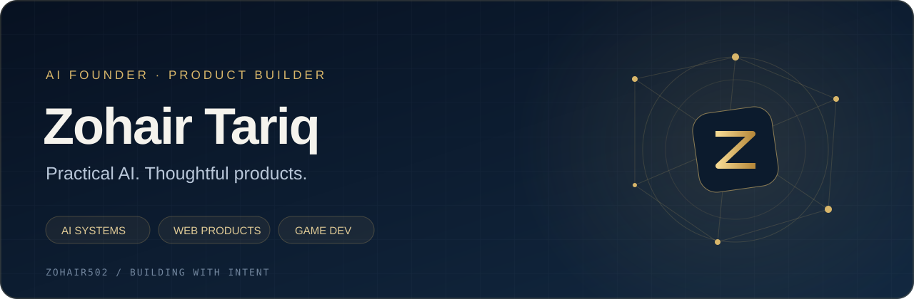
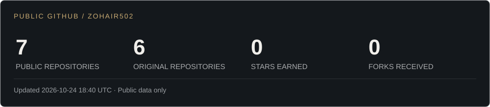

  

  <a href="https://github.com/Zohair502?tab=repositories">Explore my public work</a>
  &nbsp;·&nbsp;
  <a href="https://github.com/Zohair502/Zohair502/commits/main/">Development log</a>

## Building useful things with AI

I'm **Zohair Tariq**, an AI founder and product builder working across business software, web experiences, and games. I enjoy turning complex workflows into products that are clear and useful.

My focus: practical AI, thoughtful interfaces, and the details that make a product work.

## Selected work

| Project | What I'm building | Access |
| :--- | :--- | :--- |
| **AI Accounting System** | AI-assisted accounting software for a private client. | **Private client project** · high-level overview only. |
| **InnoTravel** | A travel web project. | [Public repository](https://github.com/Zohair502/inno-travel-webpage) · implementation has not been published in this repository yet. |
| **Don't Let It Fall** | A 3D browser game built with Defold and Lua, focused on movement and survival. | **Private source** · public code and play links are not currently listed. |

## Tools I build with

  

## On my workbench

- **AI & business software** — making complex everyday workflows easier to use.
- **Web products** — clear interfaces and useful user journeys.
- **Game development** — responsive controls, progression, and a satisfying retry loop.

This is a curated view of my work. Client source code, data, and internal details stay private.

## Public GitHub, at a glance

Stats cover public repositories only, including public forks. Stars and forks are totals across public repositories I own, excluding repositories that are themselves forks. The card shows its latest successful refresh time.

## A little motion from my contribution graph

  <a href="https://github.com/Zohair502/Zohair502/actions/workflows/profile.yml">Profile refresh status</a>
  &nbsp;·&nbsp;
  <a href="https://github.com/Zohair502?tab=repositories">Public repositories</a>

Practical AI. Thoughtful products. Always building.

