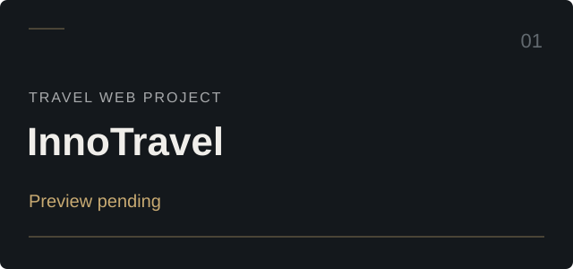
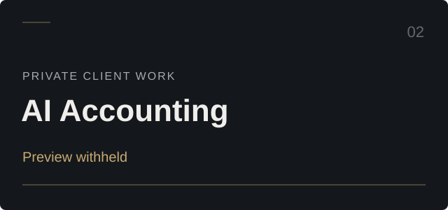
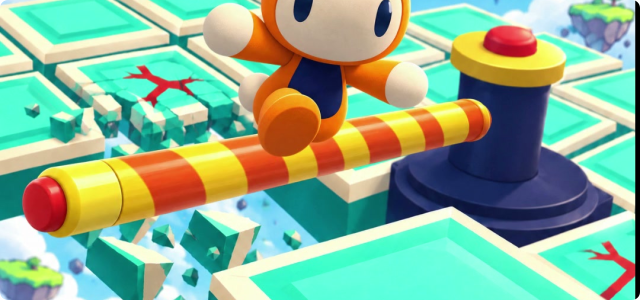
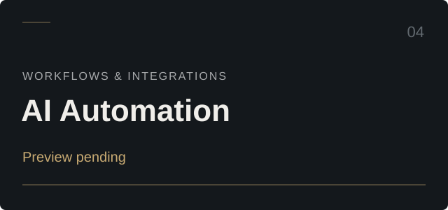

<picture>
  <source media="(max-width: 600px)" srcset="./assets/hero-mobile.svg" />
  
</picture>

I build AI systems, web products, and games, with a focus on useful software and thoughtful interfaces.

[Selected work](#selected-work) · [Technical stack](#technical-stack) · [Current focus](#current-focus) · [Activity](#contribution-activity)

## Selected work

<table>
  <tr>
    <td width="50%" valign="top">
      
      <h3>InnoTravel</h3>
      
A travel web project.

      
<a href="https://github.com/Zohair502/inno-travel-webpage">Public repository ↗</a> Repository reserved; implementation not published yet.

    </td>
    <td width="50%" valign="top">
      
      <h3>AI Accounting System</h3>
      
AI-assisted accounting software for a private client.

      
<strong>Private client project</strong> Overview only. Source, data, and internal screens stay private.

    </td>
  </tr>
  <tr>
    <td width="50%" valign="top">
      
      <h3>Don't Let It Fall</h3>
      
A 3D browser survival game. Keep moving as the platform falls away.

      
<strong>Defold · Lua · HTML5</strong> Existing project artwork. Source private; public play link pending.

    </td>
    <td width="50%" valign="top">
      
      <h3>AI Automation</h3>
      
Practical AI tools and integrations for everyday business workflows.

      
<strong>Overview</strong> Public demo and project preview pending.

    </td>
  </tr>
</table>

## Technical stack

**Applications** — Python · JavaScript · TypeScript · HTML / CSS · SQL

**Games & delivery** — Lua · Defold · Git · GitHub Actions

## Current focus

- **Business software:** accounting systems and practical workflow automation.
- **Don't Let It Fall:** controls, progression, and the retry experience.
- **This profile:** a curated public record, with daily stats from GitHub's API.

## Public GitHub

<a href="https://github.com/Zohair502?tab=repositories">
  <picture>
    <source media="(max-width: 600px)" srcset="./assets/github-stats-mobile.svg" />
    
  </picture>
</a>

Public repositories only. Stars and forks count repositories I own that are not forks. Refreshed daily; the timestamp shows the last successful update.

## Contribution activity

A daily animation of GitHub's contribution calendar. It does not create contributions or represent a score.

[Public repositories ↗](https://github.com/Zohair502?tab=repositories) · [Profile refresh status ↗](https://github.com/Zohair502/Zohair502/actions/workflows/profile.yml)
